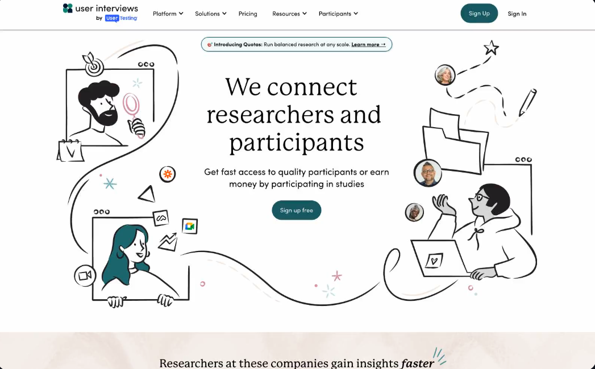
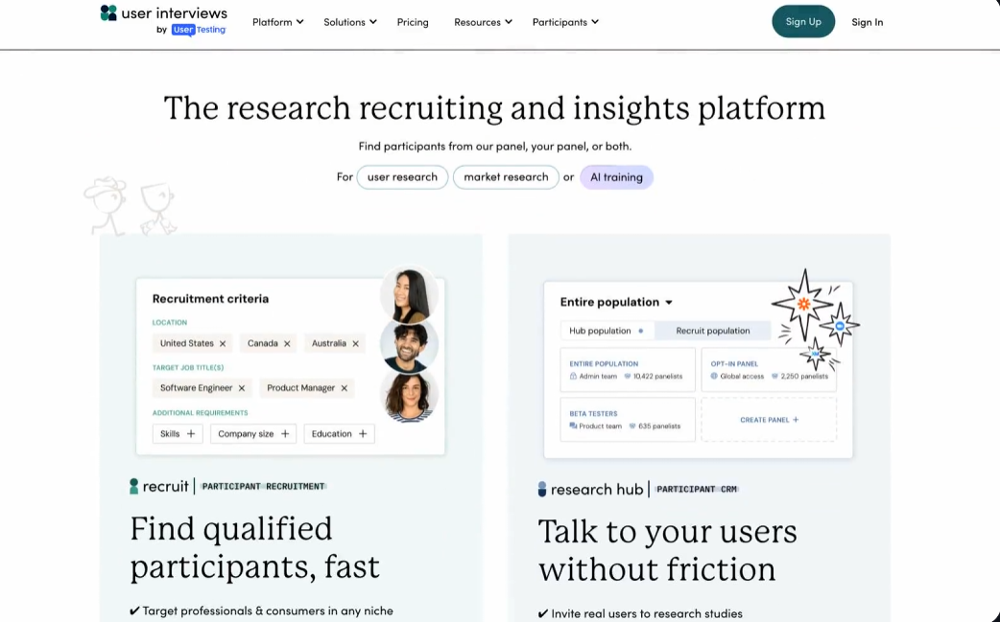
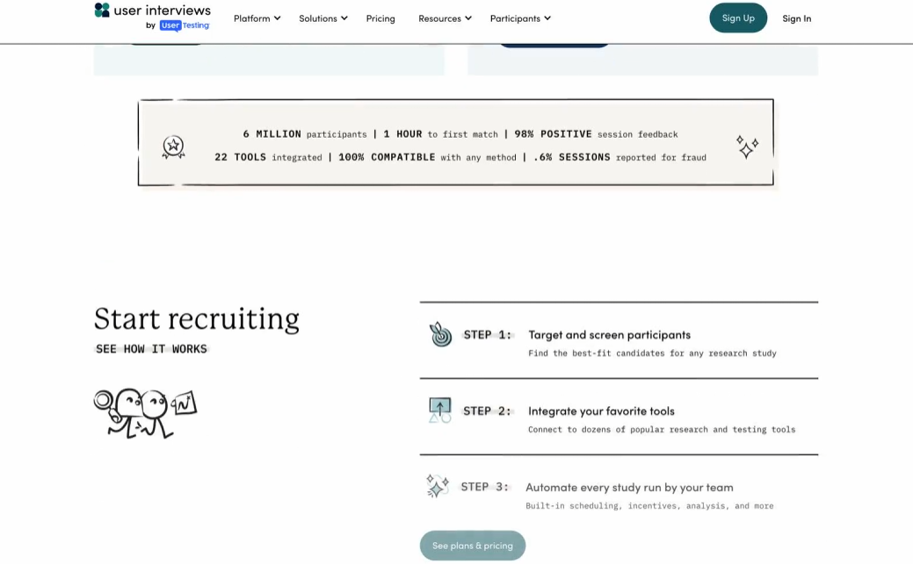

# 前端设计

## 项目品牌


品牌字样为`CampusDelivery Station`。Logo采用杨振煜于2026-11-19确认的「校园驿站」方案，深青色门廊`#0e4749`与青绿色包裹`#65b8a2`共同表达校园快递收发站点。

登录页、工作台导航及强制改密页共用[品牌SVG](assets/campus-delivery-station.svg)。品牌栏图标使用`34×34px`，右侧显示品牌字样。窄栏中`Station`可换行。浏览器标签图标引用同一SVG。图标与品牌字样相邻时，图像使用空替代文本。

## 页面底色

登录入口、学生端页面及工作人员和管理员工作台的页面底色统一使用米白`#FAF8F3`，通过公共设计变量`--surface-0-l`设置页面最外层背景。

## 界面文案

避免不必要的次要标签、说明文字、辅助文案、描述性文字和冗余的微文案，让布局、视觉层级、间距和清晰的主操作自己完成解释。


## 这个 skill 在解决什么

模型不是在设计，而是在**取众数**：把训练数据里"现代界面"求一个最大公约数端给你。所以默认产出永远是"平均设计"——单看每一项都对，放一起就是全网同款制服：蓝紫渐变、Inter、四等分卡片、1px 灰边框、毛玻璃。

差距不在模型参数量，在**输入里有没有源码级的细节**。这条链路是：

> 审美感受 → 可执行参数（色值/字重/时长/缓动）→ 写进项目规则 → AI 每次生成都自动带上

本 skill 提供的就是中间那一层参数，以及把它们落进代码的做法。判断标准很简单：**改完之后，把产品名遮住，还能认出这是谁的界面。**

## 什么时候用，什么时候别用

| 场景 | 用法 |
| --- | --- |
| AI 客户端、聊天、Copilot、Agent 面板 | 五个细节全上，这是它们的主场 |
| 落地页、作品集、官网 | 全上，第 1、3、5 条收益最大 |
| 数据密集型后台、表格、监控大盘 | 只上 1、2、4；第 3（逐字模糊）会拖慢信息获取，第 5 慎用弹性 |
| 强合规/无障碍场景（政务、医疗、金融） | 参数照用，但必须逐项过 WCAG：微明度色阶不能作为唯一状态标识 |

微明度色阶（1%~3% 亮度差）在 WCAG 对比度计算里几乎为 1:1，**它只负责氛围，不负责传达状态**。凡是靠色阶表达"选中/错误/禁用"的地方，必须补图标、文字或形状。

## 工作流

不要一上来就写代码。按这四步走，返工最少。

### 第 1 步：先定 token，再定组件

界面"平"通常不是颜色的问题，是**层级没有货币**。先把下面这组 token 定死，后面所有组件只准引用，不准写死数值。

```css
:root {
  /* 暗色：四层"黑"，每层只差 1%~3% 亮度 —— 这是整个方法的地基 */
  --surface-0: #0B0B0B;  /* 页面底 */
  --surface-1: #151515;  /* 卡片 */
  --surface-2: #1A1A19;  /* 卡片内浮层 / hover */
  --surface-3: #20201F;  /* 弹窗 / 菜单 / 输入框 */

  /* 亮色表面层级 */
  --surface-0-l: #FAF8F3;  /* 项目页面底色：米白 */
  --surface-1-l: #FFFFFF;
  --surface-2-l: #F4F1EA;
  --surface-3-l: #EDE9E0;

  /* 分隔不用边框，用"几乎看不见"的 hairlines */
  --hairline-dark: rgba(255, 255, 255, 0.06);
  --hairline-light: rgba(0, 0, 0, 0.06);

  /* 字重：暗色下整体 -40（见细节 2） */
  --fw-regular: 360;
  --fw-medium: 460;
  --fw-semibold: 540;
  --fw-bold: 560;

  /* 动效：两套性格，不是一个 spring 打天下（见细节 5） */
  --ease-snap: cubic-bezier(0.2, 0, 0, 1);      /* 过阻尼：零延迟咬死 */
  --ease-spring: cubic-bezier(0.34, 1.56, 0.64, 1); /* 欠阻尼：Q 弹 */
  --dur-snap: 180ms;
  --dur-spring: 320ms;
}
```

字体单独处理：标题绝对不要用 Inter。换一款有性格的（Satoshi / Geist / Instrument Serif / 思源宋体），正文再用 Inter 或系统字体兜底。**标题换字体是性价比最高的一刀**，比调十次配色都明显。

### 第 2 步：把规范写进项目规则，别每次重打

一次性 prompt 会随对话漂移，项目级规则不会。按所用工具落到对应文件：

- Claude Code → `CLAUDE.md`
- Cursor → `.cursorrules` / `.cursor/rules/*.mdc`
- Codex / 通用 → `AGENTS.md`
- 只想单次生效 → 对话里直接贴 `references/prompt-template.md`

规则文件里的写法要点：**用"禁止 + 替代方案"成对出现**，只写"要高级"等于没写。模板见 `references/prompt-template.md`，可直接整段复制。

### 第 3 步：按五个细节实现

逐条实现，每条都给了症状、原理、参数和代码。代码在 `references/snippets.md`。

#### 细节 1 · 扔掉黑粗边框，用微明度色阶分层

**症状**：卡片、输入框、弹窗全靠 1px 灰边框划分，界面像一张被切碎的表格；或者反过来，暗色底直接用 `#000` 纯黑，文字压上去发飘、边缘发毛。

**原理**：真实界面里物体是靠"离光源远近"分层的，不是靠描边。相邻两层只差 1%~3% 亮度时，人眼读到的是"浮起来"，而不是"画了个框"。纯黑（`#000`）在 OLED 上对比过强，反而刺眼，且没有继续往下压的空间。

**参数**：`#0B0B0B → #151515 → #1A1A19 → #20201F`，四层够用，别超过五层——层数一多，1% 的差就分不出来了。

**聚焦态**：不要用系统默认的亮蓝 outline（视频里直接打叉的那种）。改成"提一阶 surface + 一圈极淡的 hairline"，或者 `box-shadow: 0 0 0 3px color-mix(in oklab, var(--accent) 18%, transparent)`，让焦点是"亮了一点"，不是"被框住了"。

**验收**：截图转灰度，如果还能一眼看出卡片边界，说明对比过头；如果完全看不出层级，说明色阶太挤。

#### 细节 2 · 暗色模式字重悄悄减细一档

**症状**：亮色模式下调好的排版，切到暗色模式立刻"变胖"，标题糊成一团，正文发胀。

**原理**：光渗效应（optical irradiation）。亮色笔画在暗背景上会向外"溢光"，视觉上比实际更粗。这不是错觉，是视网膜的横向抑制。所以暗色模式不能沿用亮色的字重，必须整体下移。

**参数**：全站 `-40`，即 400→360、500→460、580→540、600→560。

**实现前提**：需要可变字体（variable font）。静态字体没有 360 这个字重，会回落到 300 或 400 造成跳变。所以：

```css
/* 有可变字体就用精确值 */
font-variation-settings: "wght" 360;

/* 没有就把整档降一级，别硬写 360 */
@supports not (font-variation-settings: normal) {
  .dark body { font-weight: 300; }
}
```

**验收**：亮暗两版并排截图，同一段正文的"墨量"应当接近，而不是暗色版明显更重。

#### 细节 3 · 流式打字像水墨晕染，不是一个字一个字硬蹦

**症状**：`setInterval` 每 30ms 往 DOM 里 push 一个字符，字是"蹦"出来的——每个字瞬间从无到有，边缘生硬，整段像打字机在敲铁皮。

**原理**：真实书写有"落笔"过程。给每个新出现的字符一个 120ms 的"从模糊到清晰"，相邻字符错开 30ms 起步，视觉上就变成一段连续的晕染，而不是离散的蹦字。注意是**错开**而不是**同时**：同时模糊会像整段在呼吸，反而更怪。

**参数**：`blur(6px) → 0`、`opacity 0 → 1`、单字 120ms、stagger 30ms。

**配套**：正文行内的小图标（复制、链接、外链箭头）默认贴着基线，视觉中心和文字中心差半个字高，看着"掉下去了"。统一 `vertical-align: -0.125em`（往下挪 1/8 字高），图标中心和文字中心才对齐。

**验收**：录屏逐帧看，字符应当有"由虚到实"的两三帧过渡；随机抽一行带图标的正文，图标中心与文字中心高度差 ≤1px。

#### 细节 4 · 两行代码治抖动

**症状**：① 计时器 `12 秒 → 8 秒` 跳动时整行左右抖，因为数字 1 比 8 窄；② 折叠面板展开时高度是"跳"上去的，或者要靠 JS 读 `scrollHeight` 再写 `style.height`，异步一慢就抽搐。

**原理**：① 比例字体里数字宽度不等，字符数一变，整行重排；`tabular-nums` 强制等宽数字，宽度锁死。② `grid-template-rows: 0fr → 1fr` 让浏览器自己算高度，纯 CSS 就能过渡，不需要 JS 测量。

**参数**：`font-variant-numeric: tabular-nums`；`grid-template-rows: 0fr` ↔ `1fr`，配合子元素 `overflow: hidden`。

**验收**：让计时器从 9 跳到 10、从 99 跳到 100，观察右侧文字有没有横向位移；折叠面板连点五次，不应出现高度跳变或残影。

#### 细节 5 · 动效也分性格

**症状**：全站一个 `transition: all .3s ease`，拖拽侧边栏要"滑"半秒才到位，点赞却软绵绵没有反馈；提示"复制成功"的对勾一直挂着不走。

**原理**：动效传达的是"这个物体有多重"。**跟手的东西必须瞬间咬死**（拖拽、吸附、开关、页面切换），**情绪性的东西才允许回弹**（点赞、收藏、复制成功）。两者用同一套曲线，界面就会"说话一个调"，说不出重点。

**参数**：
- 过阻尼（over-damped）：`bounce = 0`，`cubic-bezier(.2,0,0,1)`，180~220ms，零延迟。位移结束就停，不许有余震。
- 欠阻尼（under-damped）：`bounce ≈ 0.3~0.4`，`cubic-bezier(.34,1.56,.64,1)`，300~360ms，允许一次回弹。
- 一次性反馈 2.5s 后自动收起：`setTimeout(hide, 2500)`。
- 必须尊重 `prefers-reduced-motion: reduce`，此时全部退化为 `opacity` 淡入。

**验收**：快速拖拽侧边栏，松手瞬间应当"啪"地贴住，不能看到回弹；点赞时应当有且只有一次回弹。

### 第 4 步：交付前自检

跑 `references/checklist.md`。至少覆盖：暗色截图、字重对比、计时器跳变、折叠连点、拖拽手感、`prefers-reduced-motion`、对比度。

## 反模式清单：看到就删

这些是"平均设计"的指纹，删掉比加东西更有效：

- 蓝紫渐变背景（`indigo-500` 那个紫是 AI 界面的非官方国旗）
- 毛玻璃（`backdrop-filter: blur()`）当装饰用
- 四个卡片排一行的 `grid-cols-4` 功能网格
- `#000` 纯黑底 + `#FFF` 纯白字
- 每个卡片都加 1px 边框 + 阴影 + 圆角三件套
- 所有 hover 都加 `scale(1.05)` 和 `bounce`
- 标题用 Inter + `font-bold`
- 大面积居中堆叠的英雄区（左文右图不对称往往更好）

## 常见失败模式

**只换配色不改层级。** 改完还是"平"，因为问题在四层 surface 没建起来，而不是颜色不好看。

**token 写在组件里。** 这一屏调好了，下一屏 AI 又自由发挥，界面开始漂移（design drift）。约束必须落在项目级文件里。

**五个细节全上但不分场景。** 数据后台加逐字模糊，用户会想砸键盘。先判断这是"要被看的界面"还是"要被用的界面"。

**把 1% 色阶当状态色用。** 选中态、错误态靠 1% 亮度差表达，用户根本看不见，无障碍也过不了。

## 参考文件

- `references/prompt-template.md` —— 可直接整段粘给 AI 的规范文本（含中文 prompt.md 版本）
- `references/snippets.md` —— 五个细节的 CSS / React 实现代码
- `references/checklist.md` —— 交付前逐项自检清单
- `assets/demo.html` —— 左右对照的可跑示例（左边"随手搓"，右边五个细节全开），改完参数可直接刷新看效果

## User Interviews浅色风格参考

本节整理负责人提供的User Interviews风格资料，作为界面设计的外部参考。原始测量值已经归一化，部分角色和使用建议属于整理者解释，HTML示例也不是原站组件源码；不能将本节当作User Interviews官方设计系统或已经完成的本项目实现。

本节与项目已确认的品牌字样、配色、字体或业务规则不一致时，不自动替换现行约定。实际采用前须由项目负责人协调评审，并同步受影响的原型和组件。参考资料未规定中文渲染方式，不能据此改变项目中文字体规则。

### 风格定位与适用边界

核心气质是“暖纸上的手绘研究笔记”：以带轻微薄荷色的暖白画布承载内容，用文学感衬线标题、几何无衬线正文和等宽大写标签建立编辑出版感，再以深青色主操作和手绘人物插画表现“以人为本的研究”。

- 采用浅色、扁平、低视觉噪声的色面分层，不用投影制造层级。
- 胶囊按钮、薄荷色卡片和手绘人物是主要识别特征。
- 双列产品卡片、居中大标题、客户Logo栏等营销页结构只用于确有对应内容的页面，不机械套用到表格、表单和高频业务工作台。
- 插画和装饰不得挤压业务控件空间，也不能代替字段标签、状态文字或错误说明。

### 色彩与表面

| 名称 | 色值与变量 | 参考职责 |
| --- | --- | --- |
| Deep Teal | `#1c5d5f`，`--color-deep-teal` | 唯一主操作填充色，配白色文字 |
| Forest Floor | `#156152`，`--color-forest-floor` | 主操作悬停、按下或选中状态 |
| Pine Shadow | `#0e4749`，`--color-pine-shadow` | 描边按钮、次要链接及焦点边界 |
| Ink Navy | `#16325a`，`--color-ink-navy` | 代表另一产品方向的次要有填充按钮 |
| Sage | `#65b8a2`，`--color-sage` | 插画、装饰笔触及次要描边 |
| Lake Teal | `#2a7779`，`--color-lake-teal` | 插画填色和装饰边界 |
| Dusty Rose | `#d6aec1`，`--color-dusty-rose` | 玫瑰色装饰和插画局部填色 |
| Mint Mist | `#a2cbcd`，`--color-mint-mist` | 浅色描边、插画水洗色 |
| Sea Foam | `#cae1e2`，`--color-sea-foam` | 高光和装饰背景 |
| Paper White | `#f2f8f7`，`--color-paper-white` | User Interviews参考画布，项目采用[米白页面底色](#页面底色) |
| Card Mint | `#e4f0f1`，`--color-card-mint` | 普通卡片和功能面板 |
| Blush Sand | `#f2e8e2`，`--color-blush-sand` | 交替区块和暖色插画背景 |
| Charcoal Navy | `#283338`，`--color-charcoal-navy` | 主要文字、导航及导航边界 |
| Slate | `#333333`，`--color-slate` | 正文和次级标题 |
| Soft Black | `#1a1a1a`，`--color-soft-black` | 链接及高对比文字 |
| Illustration Ink | `#231e21`，`--color-illustration-ink` | 手绘轮廓和局部实色 |

表面层级依次为页面画布`#f2f8f7`、卡片薄荷色`#e4f0f1`、暖沙色`#f2e8e2`和浅海沫色`#cae1e2`。卡片依靠色面、留白及必要的1px细边界区分，禁止添加装饰性投影。

同一视口最多设置一个深青色主按钮。藏青色按钮只用于确实存在的第二产品方向，不能作为同一操作的随意变体。浅青色、灰粉色和装饰色不直接承担成功、错误、警告、禁用等业务语义；状态仍须使用项目确认的文字、图标和形状，并单独校验对比度。

### 字体与排版

| 角色 | 字体及变量 | 字重与参考字号 | 使用规则 |
| --- | --- | --- | --- |
| 展示及区块标题 | P22 Mackinac Pro，`--font-p22-mackinac-pro` | 400、500；`30px`、`44px`、`50px`、`64px` | 正常字距，行高约`1.16～1.33`；不使用无衬线字体代替其编辑感 |
| 标题强调 | P22 Mackinac Pro Italic，`--font-p22-mackinac-pro-italic` | 700；`30px`、`36px`、`50px` | 仅用于标题中的局部斜体强调 |
| UI与正文 | Sofia Pro，`--font-sofia-pro` | 400、500、700；`12～24px` | 正文常用`16～18px`；小字号标签字距约`0.043em`，大字号可收紧至`-0.01em` |
| eyebrow与统计标签 | IBM Plex Mono，`--font-ibm-plex-mono` | 400、500、600；`13～20px` | 大写、较宽字距；`13px`约`0.059em`，`14px`约`0.038em` |

原资料中的重复斜体字体名称已合并，不另建一套字体的角色。参考替代字体分别为Source Serif 4或Lora、Inter或DM Sans或Manrope、JetBrains Mono或Fira Code；替代字体只能近似风格，接入后仍须检查字宽、换行和实际渲染结果。字体来源、网页分发授权及中文显示方案须另行确认。

| 类型角色 | 字号变量 | 行高 | 字距 |
| --- | --- | --- | --- |
| caption | `12px`，`--text-caption` | 1.5 | `0.52px` |
| body-sm | `14px`，`--text-body-sm` | 1.43 | 0 |
| body | `16px`，`--text-body` | 1.5 | 0 |
| subheading | `20px`，`--text-subheading` | 1.4 | `-0.2px` |
| heading-sm | `24px`，`--text-heading-sm` | 1.38 | `-0.24px` |
| heading | `44px`，`--text-heading` | 1.2 | 0 |
| heading-lg | `50px`，`--text-heading-lg` | 1.16 | 0 |
| display | `64px`，`--text-display` | 1.2 | 0 |

大标题和展示字号是营销页的参考上限，不作为业务页面的默认字号。正文、表格和表单优先保证阅读效率与信息密度；标题不能只靠加大字号制造层级。

### 间距、圆角与布局

- 间距基准为`8px`，参考序列为`8、16、24、32、40、48、56、64、88、112px`，对应`--spacing-8`至`--spacing-112`。
- 普通卡片内边距从`24px`起步，双列功能卡片可使用`32px`；主要区块间距参考`88px`，业务页面按内容密度缩减。
- 按钮圆角为`48px`，导航胶囊为`88px`，标签为`100px`，胶囊容器可使用`1000px`；普通卡片圆角为`12px`。对应变量分别为`--radius-buttons`、`--radius-nav`、`--radius-tags`、`--radius-pills`和`--radius-cards`。
- 营销内容最大宽度参考`1200px`并居中。首屏可采用居中衬线标题、两侧手绘插画和下方主按钮，后接客户信任栏、双列功能卡及统计横条。
- 数据表格、密集表单和工作台不因上述布局参考强制使用`1200px`或双列卡片，仍按项目响应式和主流程要求设计。

### 组件参考

| 组件 | 整理后的设计规则 |
| --- | --- |
| 主按钮 | `#1c5d5f`填充、白字、`48px`圆角、无描边；Sofia Pro `14px/500`，内边距`12px 24px`；悬停使用`#156152` |
| 藏青按钮 | `#16325a`填充、白字，沿用主按钮尺寸与圆角；仅表达第二产品方向 |
| 幽灵按钮 | 透明底、`1px #0e4749`描边和同色文字、`48px`圆角，用于三级操作 |
| 顶部注册按钮 | 深青色填充、白字、`48px`圆角，紧凑内边距`8px 16px`；仍须满足项目最小点击区要求 |
| 导航项 | Sofia Pro `14px/400`、`#283338`；默认无填充和描边，选中态可使用浅胶囊底或深青文字，并同时提供语义状态 |
| eyebrow标签 | IBM Plex Mono `13～14px`、大写、宽字距，前缀一个约`6px`的青色、藏青或灰绿圆点 |
| 双列功能卡 | 两列等宽；卡片使用`#e4f0f1`、`12px`圆角和`32px`内边距；上方为产品UI示意，下方为标题、说明和勾选列表 |
| 勾选列表 | 每项使用深青色粗体勾号，正文为Sofia Pro `16px`；项间距`8px`，勾号固定在独立缩进列 |
| 筛选胶囊 | `#e4f0f1`底、`#283338`字、内边距`6px 14px`；选中时可用深青底白字，同时保留可访问的选中状态 |
| 统计横条 | 全宽细边框区域，等宽大写文字；数字字重600、标签400，各项以`#a2cbcd`细分隔线分开 |
| 客户Logo栏 | 居中排列的灰度Logo，不使用各自完整品牌色；仅在实际获得授权且确有对应内容时采用 |
| AI公告胶囊 | 薄荷色底、`1px #a2cbcd`边界、全胶囊圆角，可包含星形图标、简短说明和深青色文字链接 |
| 产品UI示意卡 | 白底、`12px`圆角和细边界，展示筛选、表单项或统计等真实结构；示意数据不冒充业务联调结果 |

组件中的色值和字号是参考参数，不覆盖项目公共组件的业务状态、键盘操作和响应式约束。不得为了复刻营销页而增加无关公告、客户背书、虚构统计或未确认的产品入口。

### 插画语言

人物采用约`2px`的`#231e21`手绘线条，面部用点眼睛和单线嘴部等简化表达，头发使用实色块。人物可位于带三个窗口圆点的浏览器框内或旁侧，衣服和局部道具选用`#65b8a2`、`#16325a`、`#d6aec1`等有限填色。

星芒、箭头、圆圈、加号、植物、对话框等装饰散落在人物周围，整体保持速写感而非企业素材库风格。不用摄影替代手绘人物。实际项目插画仍须取材于已确认的校园快递场景，并为传达信息的图像提供替代文本；纯装饰图像应从辅助技术中隐藏。

### 反模式与落地检查

- 不使用纯白作为参考主题画布，不给卡片添加投影，不引入蓝紫渐变或装饰性毛玻璃。
- 不增加青色、藏青色和描边变体之外的按钮颜色，不为标题改用无衬线字体，不为eyebrow使用普通正文排版。
- 不把低明度色阶当作唯一状态提示，不用装饰动效阻塞读取和操作，继续执行项目的对比度、键盘、触控和减少动态效果要求。
- 落地时集中维护设计变量，组件只引用变量。若使用Tailwind v4，可将同名变量注册到`@theme`；注册变量不代表字体、组件或页面已经实现。
- 采用本参考前，以实际页面检查字体授权与加载、文字对比度、长中文文案、三档视口、200%缩放和业务状态，不能以静态风格稿代替运行验收。

### 参考图与来源

以下图片用于核对原始构图、色面和插画关系，不作为本项目已确认页面或运行截图。

**图1：首屏的居中衬线标题、两侧手绘人物与单一主按钮**



**图2：双列薄荷色功能卡、产品UI示意与等宽标签**



**图3：统计横条、细横线分组与步骤说明**



**图4：独立深色横幅、手绘人物和内容卡片**


来源：[User Interviews官网](https://www.userinterviews.com/)。页面内容可能更新，以仓库内参考图和本次整理记录为复核依据。
